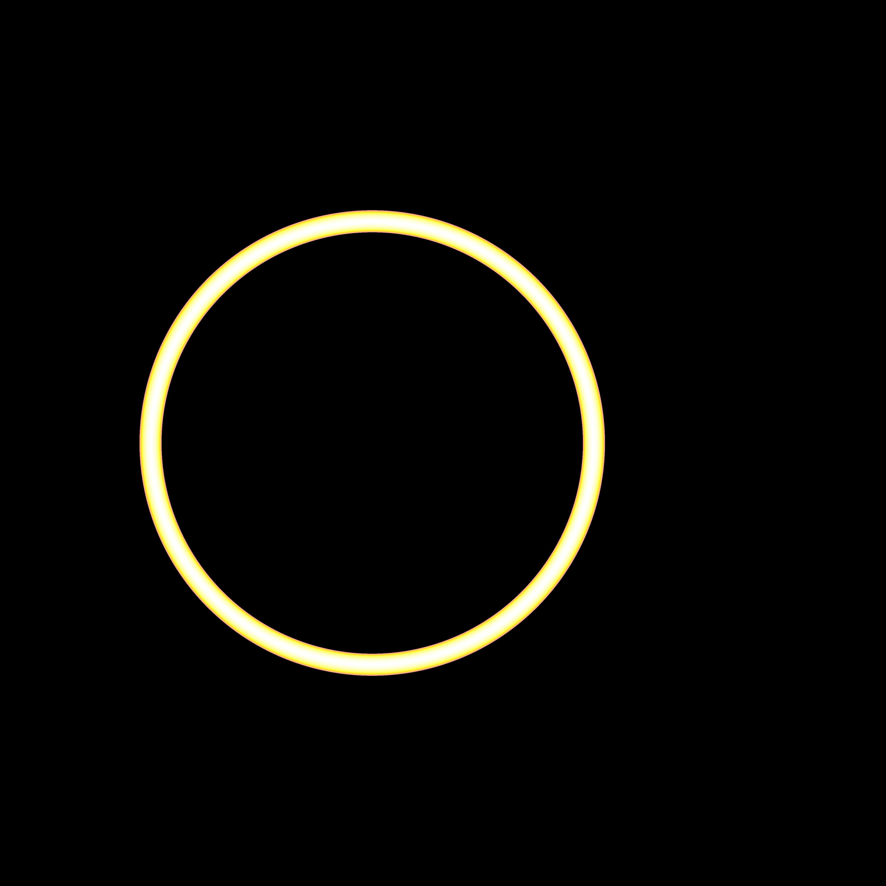
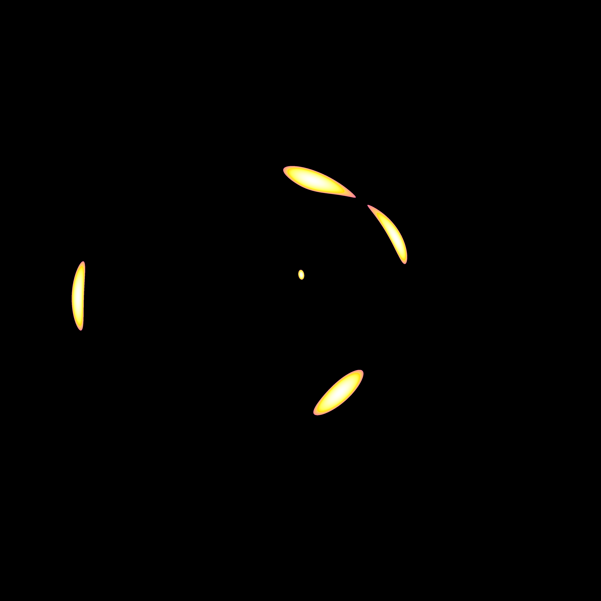
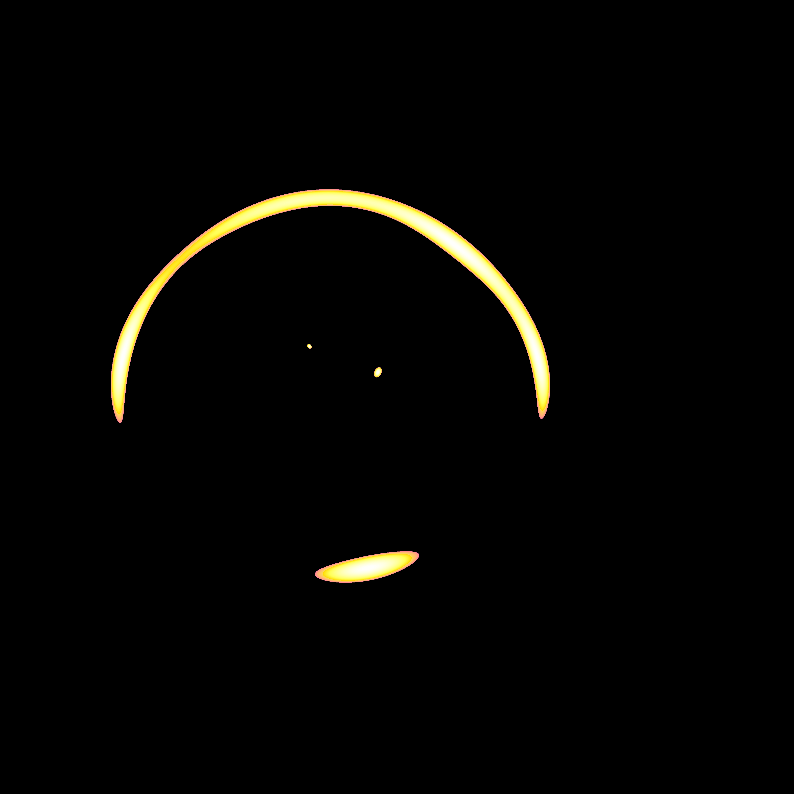
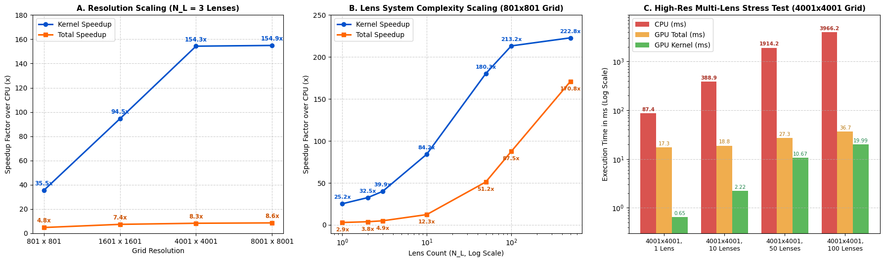

# GPU-Accelerated Gravitational Microlensing Simulation (CUDA C++)

High-performance parallel inverse ray-tracing simulation of gravitational microlensing systems implemented in **CUDA C++** on an **NVIDIA Tesla T4 GPU** (Turing Architecture, Compute Capability 7.5).

---

## 1. Overview & Mathematical Formulation
Gravitational microlensing occurs when foreground stars ("lenses") deflect light rays from a background source star due to spacetime curvature. Rather than directly solving a high-order complex polynomial for image positions, this project implements **inverse ray tracing**: dividing the lens plane $[-2, 2] \times [-2, 2]$ into millions of pixels and shooting light rays backward from each pixel to the source plane using the multi-lens equation:

$$\zeta = z - \sum_{i=1}^{N_L} \frac{\epsilon_i}{\bar{z} - \bar{z}_{m,i}}$$

Rays landing within the source star radius ($r_{\text{star}}$) are weighted using a stellar limb-darkening profile ($\lambda = 0.5$):

$$f = 1 - \lambda(1 - \mu), \quad \mu = \sqrt{1 - \left(\frac{r}{r_{\text{star}}}\right)^2}$$

---

## 2. GPU Hardware & CUDA Architecture Optimizations
* **Target Hardware:** NVIDIA Tesla T4 (40 Streaming Multiprocessors × 64 CUDA cores/SM = **2,560 FP32 CUDA Cores**, 16 GB GDDR6 VRAM, 320 GB/s memory bandwidth).
* **2D Grid & Block Topology (`dim3(16, 16)`):** Launches 256 threads (8 warps) per block, enabling up to 4 concurrent blocks (1,024 active threads) per SM for 100% occupancy and latency hiding.
* **Coalesced Global Memory Writes:** Flattens the 2D image buffer into a 1D device pointer (`float* lensim_d`) indexed via `iy * npixx + ix`, ensuring adjacent threads in a 32-thread warp perform coalesced 128-byte memory transactions.
* **L1/Constant Cache Warp Broadcast:** Uses `const float* __restrict__` pointers in `__device__ d_shoot()` so simultaneous warp-wide reads of `xlens[i]`, `ylens[i]`, and `eps[i]` are broadcast from cache in a single transaction.

---

## 3. Gravitational Lensing Visualizations (8001×8001 Grid)

| Single Lens ($N_L = 1$) | Binary Lens ($N_L = 2$) |
| :---: | :---: |
|  |  |
| *Symmetric Einstein ring around central point mass* | *Split critical curve and distorted caustic arcs* |

| Triple Lens ($N_L = 3$) | Complex Star Field ($N_L = 100$) |
| :---: | :---: |
|  |  |
| *Multiple secondary lensed images around primary ring* | *Intricate micro-caustic network across 100 point masses* |

---

## 4. Performance Benchmarks (NVIDIA Tesla T4 vs. Sequential CPU)



### A. Resolution Scaling ($N_L = 3$ Lenses)
| Grid Resolution | Lens Scale | GPU Kernel (ms) | GPU Total (ms) | CPU (ms) | Kernel Speedup | Total Speedup |
| :--- | :--- | :--- | :--- | :--- | :--- | :--- |
| **801 × 801** | 0.005 | 0.17 ms | 1.25 ms | 6.04 ms | **35.5x** | 4.8x |
| **1601 × 1601** | 0.0025 | 0.25 ms | 3.27 ms | 24.04 ms | **94.5x** | 7.4x |
| **4001 × 4001** | 0.001 | 0.95 ms | 17.71 ms | 147.14 ms | **154.3x** | 8.3x |
| **8001 × 8001** | 0.0005 | 3.83 ms | 68.83 ms | 593.80 ms | **154.9x** | 8.6x |

### B. Lens System Complexity Scaling ($801 \times 801$ Grid)
| Lens Count ($N_L$) | GPU Kernel (ms) | GPU Total (ms) | CPU (ms) | Kernel Speedup | Total Speedup |
| :--- | :--- | :--- | :--- | :--- | :--- |
| **1 Lens** | 0.14 ms | 1.20 ms | 3.47 ms | **25.2x** | 2.9x |
| **10 Lenses** | 0.18 ms | 1.26 ms | 15.43 ms | **84.2x** | 12.3x |
| **100 Lenses** | 0.74 ms | 1.80 ms | 157.63 ms | **213.2x** | 87.5x |
| **500 Lenses** | 3.50 ms | 4.57 ms | 780.39 ms | **222.8x** | **170.8x** |

### C. High-Resolution Multi-Lens Stress Test ($4001 \times 4001$ Grid)
| Configuration | GPU Kernel (ms) | GPU Total (ms) | CPU (ms) | Kernel Speedup | Total Speedup |
| :--- | :--- | :--- | :--- | :--- | :--- |
| **4001×4001, 1 Lens** | 0.65 ms | 17.28 ms | 87.43 ms | **134.5x** | 5.1x |
| **4001×4001, 10 Lenses** | 2.22 ms | 18.83 ms | 388.92 ms | **175.2x** | 20.7x |
| **4001×4001, 50 Lenses** | 10.67 ms | 27.32 ms | 1,914.21 ms | **179.4x** | 70.1x |
| **4001×4001, 100 Lenses** | 19.99 ms | 36.66 ms | 3,966.15 ms | **198.4x** | **108.2x** |

---

## 5. Compilation & Usage
Requires NVIDIA CUDA Toolkit (`nvcc`) and the `CFITSIO` library (`-lcfitsio`).

```bash
# Compile for NVIDIA Turing architecture (Compute Capability 7.5)
nvcc -O3 -arch=sm_75 lens_cuda.cu lenses.cpp fitsfile.cpp -o lens_cuda -lcfitsio

# Run simulation: ./lens_cuda [lens_scale] [nlenses_mode] [run_cpu (0 or 1)] [out_filename]
./lens_cuda 0.0005 3 1 lens_3_highres.fit

# Run full automated benchmark suite
bash job_ass4.sh
